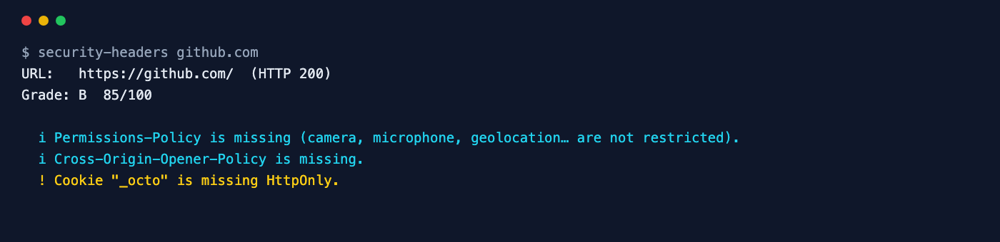

<div align="center">

# Security Headers Checker

**Grade a site's HTTP security headers from A to F — and see exactly what to fix.**

[](https://github.com/ksanyok/security-headers/actions/workflows/ci.yml) [](LICENSE)   [](https://promopilot.link/en/tools/security-headers.php?utm_source=github&utm_medium=repo&utm_campaign=tools&utm_content=security-headers)

**[▶ Use the free online version — no install, no sign-up](https://promopilot.link/en/tools/security-headers.php?utm_source=github&utm_medium=repo&utm_campaign=tools&utm_content=security-headers)**

</div>

`security-headers` fetches a page and grades the HTTP response headers browsers use to protect your visitors: HSTS, Content-Security-Policy (including whether it actually restricts scripts), `X-Content-Type-Options`, clickjacking protection via `X-Frame-Options` or `frame-ancestors`, `Referrer-Policy`, `Permissions-Policy` and `Cross-Origin-Opener-Policy`. It also checks cookie flags and headers that reveal server versions, and turns everything into a score from 0 to 100 and a grade from A to F you can enforce in CI.



## What it checks

- **Strict-Transport-Security** — present, `max-age` of at least 6 months, `includeSubDomains`
- **Content-Security-Policy** — present and enforcing (not report-only), restricts scripts, no `'unsafe-inline'` without nonces or hashes, no `'unsafe-eval'`, no wildcard script sources, `object-src`
- **X-Content-Type-Options: nosniff**
- **Clickjacking protection** — `X-Frame-Options: DENY/SAMEORIGIN` or CSP `frame-ancestors`
- **Referrer-Policy** — present and not leaking full URLs (`unsafe-url`)
- **Permissions-Policy** and **Cross-Origin-Opener-Policy**
- Cookies without `Secure`, `HttpOnly` or `SameSite`; `Server` versions and `X-Powered-By` leaks; deprecated `X-XSS-Protection`

## Why it matters

Security headers are a cheap, server-wide layer of defence: one line of configuration can stop protocol downgrade attacks, clickjacking, MIME sniffing and a large class of cross-site scripting. They are also easy to lose — a new CDN, a framework upgrade or a reverse proxy in front of the app silently drops them, and nothing visibly breaks. Grading the headers on every deploy, with a minimum grade enforced in CI, keeps the protection from regressing.

## Quick start

```bash
# run straight from GitHub, nothing to install
npx github:ksanyok/security-headers example.com

# or install the CLI globally
npm install -g github:ksanyok/security-headers
security-headers example.com
```

Fail if the grade drops below B:

```bash
security-headers https://example.com --min B
```

Analyse headers you already have (no request from this tool):

```bash
curl -sI https://example.com | security-headers --stdin
```

See every response header:

```bash
security-headers example.com --show-headers
```

## Example output

```text
$ security-headers github.com
URL:   https://github.com/  (HTTP 200)
Grade: B  85/100

  i Permissions-Policy is missing (camera, microphone, geolocation… are not restricted).
  i Cross-Origin-Opener-Policy is missing.
  ! Cookie "_octo" is missing HttpOnly.
```

## CLI

```text
Usage: security-headers <url> [options]
       curl -sI https://example.com | security-headers --stdin

Fetches a page and grades its HTTP security headers (HSTS, CSP,
X-Content-Type-Options, frame protection, Referrer-Policy, Permissions-Policy,
COOP) plus cookie flags and information leaks. Score 0-100, grade A-F.

Options:
  --stdin           Analyse a raw header block from standard input
  --file <path>     Analyse a raw header block from a file
  --min <grade>     Exit with code 1 if the grade is below this (e.g. B)
  --show-headers    Print all response headers
  --json            Print JSON
  -h, --help        Show this help

Online version (no install): https://promopilot.link/en/tools/security-headers.php?utm_source=github&utm_medium=cli&utm_campaign=tools&utm_content=security-headers
```

## Use as a library

```js
import { checkSecurityHeaders, analyzeHeaders } from '@promopilot/security-headers';

const report = await checkSecurityHeaders('https://example.com');
console.log(report.grade, report.score, report.issues);

// Offline: grade headers from your own test client or framework
analyzeHeaders({ 'strict-transport-security': 'max-age=31536000', 'x-content-type-options': 'nosniff' });
// { score, grade, issues: [{ level, code, message }] }
```

`checkSecurityHeaders(url, { fetch, userAgent })` returns `{ url, finalUrl, status, headers, score, grade, issues[] }`. `analyzeHeaders(headers, { https })` takes lowercase header names and works with any HTTP client — handy in integration tests. Issue codes are stable (`hsts-missing`, `csp-missing`, `csp-unsafe-inline`, `clickjacking`, `cookie-flags`, …).

## Use in CI (GitHub Actions)

Block a deploy that would ship weaker headers:

```yaml
on: [deployment_status]
jobs:
  headers:
    runs-on: ubuntu-latest
    steps:
      - uses: ksanyok/security-headers@v1
        with:
          args: https://staging.example.com --min B
```

## How it works

The page is requested with Node's built-in `fetch`, following redirects, and the headers of the final response are analysed (all `Set-Cookie` headers are read with `getSetCookie`). Each protection has a weight — HSTS and CSP 25 points each, frame protection 15, `nosniff`, Referrer-Policy and Permissions-Policy 10, COOP 5 — and weak configurations earn half. The score is the share of available points (HSTS is excluded for plain-HTTP pages) mapped to grades A ≥ 90, B ≥ 75, C ≥ 60, D ≥ 40, E ≥ 20, F below.

## CLI vs. online version

| | This package | [Online tool](https://promopilot.link/en/tools/security-headers.php?utm_source=github&utm_medium=repo&utm_campaign=tools&utm_content=security-headers) |
|---|---|---|
| Runs on | Your machine, CI, staging | Any browser |
| Offline analysis | Yes, `--stdin` / `--file` | — |
| CI gate | `--min <grade>` exit code | — |
| Output | Text, JSON | Visual report with example configs |
| Price | Free, MIT | Free, no sign-up |


## FAQ

<details>
<summary><b>Which headers matter most?</b></summary>

HSTS and a real Content-Security-Policy give the most protection, followed by clickjacking protection and `X-Content-Type-Options: nosniff`. The others are cheap hardening.
</details>

<details>
<summary><b>Is X-Frame-Options still needed?</b></summary>

CSP `frame-ancestors` supersedes it in modern browsers. Either one satisfies this check; sending both is harmless.
</details>

<details>
<summary><b>How do I add a CSP without breaking my site?</b></summary>

Start with `Content-Security-Policy-Report-Only` and a `report-to` endpoint, fix what gets reported, then switch to the enforcing header. Use nonces or hashes instead of `'unsafe-inline'`.
</details>

<details>
<summary><b>Should I remove X-XSS-Protection?</b></summary>

Yes, or set it to `0`. The browser XSS auditor it controlled has been removed and could itself introduce vulnerabilities.
</details>

<details>
<summary><b>Why is my grade different from other scanners?</b></summary>

Weights and rules differ between tools. This one rewards headers that actually restrict behaviour (an enforcing CSP that limits scripts) rather than their mere presence.
</details>

<details>
<summary><b>Is there a version without installing anything?</b></summary>

Yes — the [online Security Headers Checker](https://promopilot.link/en/tools/security-headers.php?utm_source=github&utm_medium=repo&utm_campaign=tools&utm_content=security-headers) runs the same checks in the browser and explains each result.
</details>

## Related free tools

- [SSL Checker](https://promopilot.link/en/tools/ssl-checker.php?utm_source=github&utm_medium=repo&utm_campaign=tools&utm_content=ssl-checker) — certificate chain, expiry, TLS versions
- [Redirect Checker](https://promopilot.link/en/tools/redirect-checker.php?utm_source=github&utm_medium=repo&utm_campaign=tools&utm_content=redirect-checker) — trace redirect chains, loops and status codes
- [HTTP Headers Checker](https://promopilot.link/en/tools/headers-checker.php?utm_source=github&utm_medium=repo&utm_campaign=tools&utm_content=headers-checker) — security, caching and compression headers
- [Website Status](https://promopilot.link/en/tools/website-status.php?utm_source=github&utm_medium=repo&utm_campaign=tools&utm_content=website-status) — is a site down for everyone or just you
- [Robots.txt Checker](https://promopilot.link/en/tools/robots-checker.php?utm_source=github&utm_medium=repo&utm_campaign=tools&utm_content=robots-checker) — test robots.txt rules against any URL
- [All 120+ free SEO, email and web tools](https://promopilot.link/en/tools/?utm_source=github&utm_medium=repo&utm_campaign=tools&utm_content=security-headers)

## Contributing

Bug reports and pull requests are welcome — see [CONTRIBUTING.md](CONTRIBUTING.md). Security issues: [SECURITY.md](SECURITY.md).
More docs live in the [wiki](https://github.com/ksanyok/security-headers/wiki) (sources in [docs/wiki](docs/wiki)).

## License

[MIT](LICENSE) © 2026 Alexandr Krikun

---

<sub>Built and maintained by the team behind [PromoPilot](https://promopilot.link/?utm_source=github&utm_medium=repo&utm_campaign=tools&utm_content=security-headers) — link building, SEO monitoring and 120+ free tools for site owners. Also on [YouTube](https://www.youtube.com/channel/UCPB8m7BgaexcZh0Vr49ViYA).</sub>
